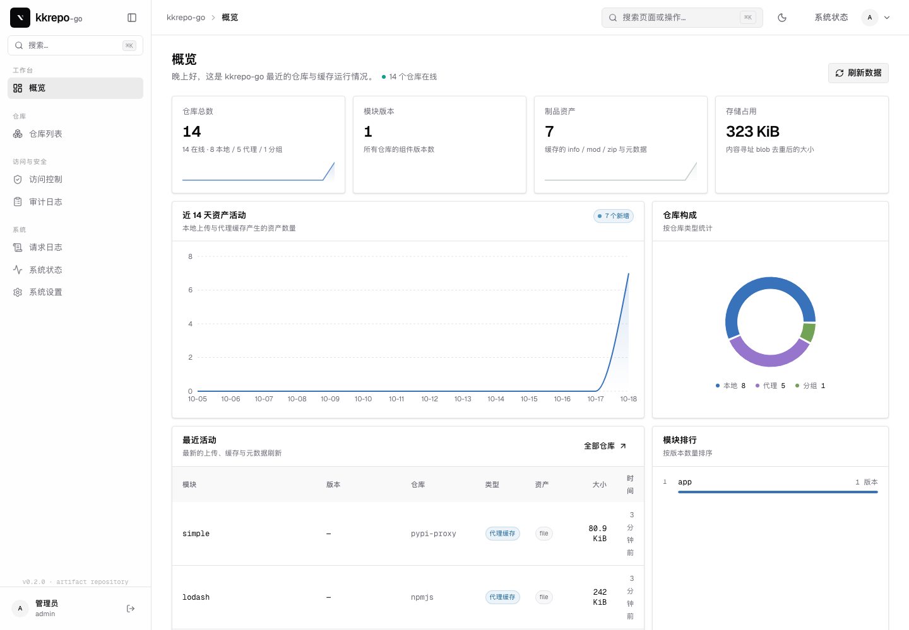
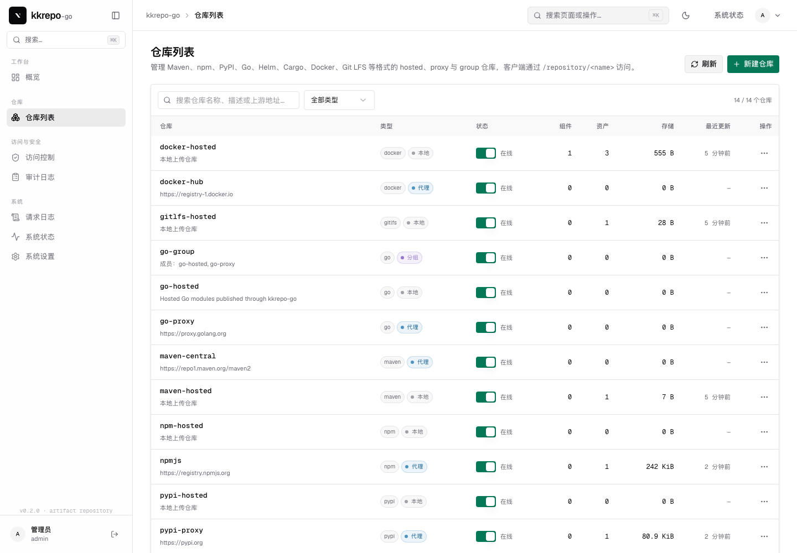
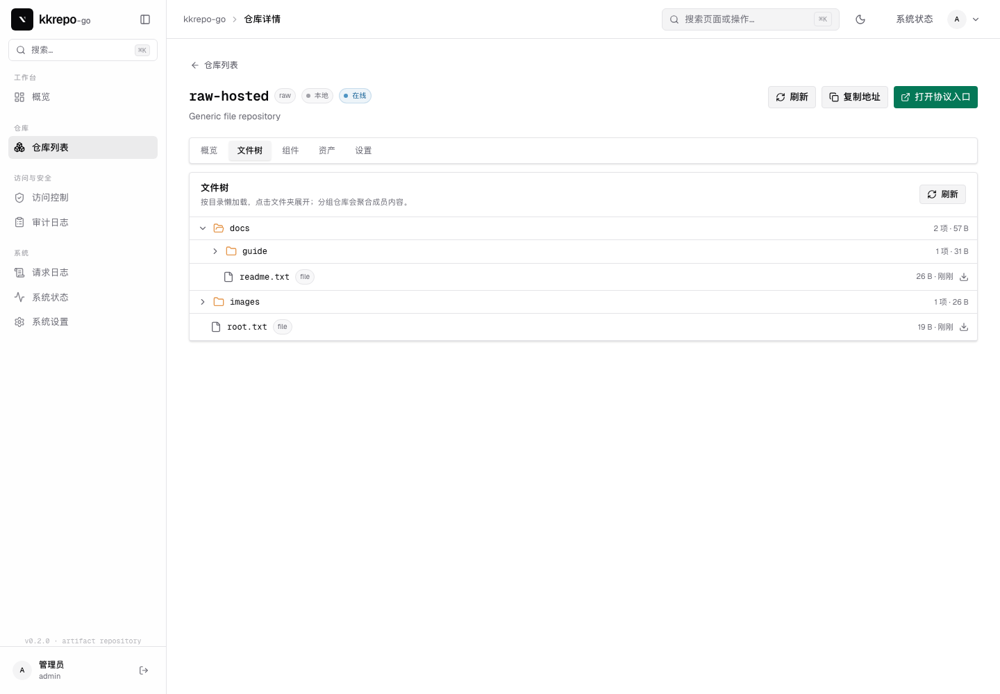
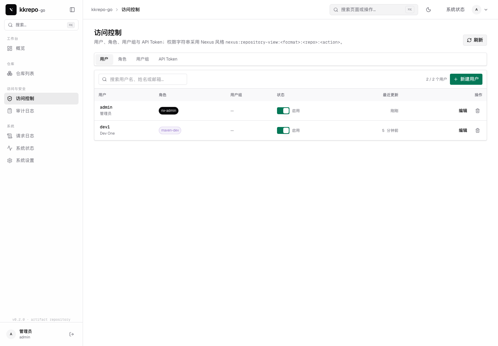
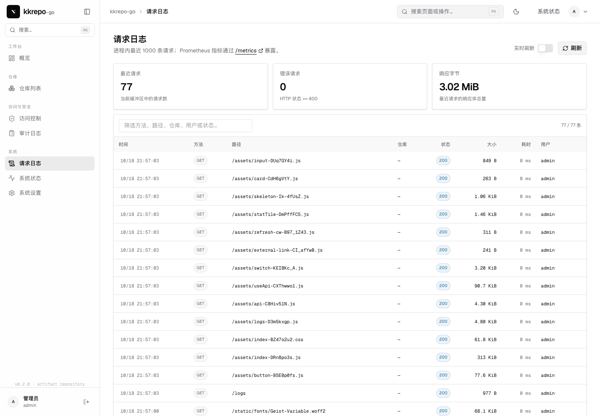

# kkrepo-go

用 **Go** 重写的 [kkRepo](../kkRepo) 多格式制品仓库，前端沿用 [bifrost-ui-demo](../bifrost-ui-demo) 的技术栈与设计规范。

- 后端：Go 1.25；核心协议仅用标准库，LDAP 与 OpenPGP 使用成熟库
- 前端：React 19 + TypeScript + Vite 8 + TanStack Router + Tailwind CSS v4 + Radix UI + recharts
- 已迁移格式：**Maven、npm、PyPI、Go、Helm、Cargo、Dart Pub、Docker/OCI、Git LFS、Conda、Swift Package Registry、APT、Alpine、Yum、Raw**
- 按需求排除：Terraform、Composer、Ansible、R / CRAN、NuGet、Hugging Face Models、RubyGems
- 后台能力：用户 / 角色 / 用户组 / 权限 / API Token / 匿名访问 / LDAP / OIDC / 审计日志 / 请求日志 / Prometheus 指标
- 签名：APT `Release` / `InRelease` / `Release.gpg`，Alpine `APKINDEX.tar.gz` RSA 签名



## 格式与能力矩阵

| 格式 | hosted | proxy | group | 协议实现要点 |
| --- | --- | --- | --- | --- |
| Go | ✅ | ✅ | ✅ | `@v/list`、`@latest`、`.info/.mod/.zip`、模块路径/版本/zip 校验、TTL、负缓存、熔断 |
| Maven | ✅ | ✅ | ✅ | 原始路径 PUT/GET/DELETE、代理缓存、分组首命中、hosted `maven-metadata.xml` 自动生成 |
| npm | ✅ | ✅ | ✅ | packument 发布、`_attachments` 解包、dist-tags、tarball、代理 tarball URL 重写 |
| PyPI | ✅ | ✅ | ✅ | multipart 上传、`/simple` 根/项目索引、`/pypi/{name}/json`、文件下载 |
| Helm | ✅ | ✅ | ✅ | `POST api/charts` / PUT chart、`index.yaml` 自动生成、代理缓存 |
| Cargo | ✅ | ✅ | ✅ | `config.json`、稀疏索引、`api/v1/crates/new` 发布、yank/unyank、下载、搜索 |
| Dart Pub | ✅ | ✅ | ✅ | 包/版本元数据、`versions/new` 上传会话、finalize、archive 路径 |
| Docker/OCI | ✅ | ✅ | ✅ | Registry v2：manifests、blobs、上传会话（PATCH/PUT）、tags、catalog、referrers、代理 Bearer token |
| Git LFS | ✅ | — | — | batch API、OID 上传/下载、verify、Range 下载 |
| Swift | ✅ | ✅ | ✅ | release 列表/元数据、multipart 发布、`Package.swift`、archive |
| Conda | ✅ | ✅ | ✅ | hosted 自动生成 `repodata.json` / `channeldata.json`；包归档与代理/分组 |
| APT | ✅ | ✅ | — | hosted 生成 `Packages` / `Release`，OpenPGP 签名 `InRelease` / `Release.gpg` |
| Alpine | ✅ | ✅ | ✅ | hosted 生成并 RSA 签名 `APKINDEX.tar.gz`；代理/分组 |
| Yum | ✅ | ✅ | ✅ | hosted 自动生成 `repomd.xml` + `primary/filelists/other.xml.gz` |
| Raw | ✅ | ✅ | ✅ | 任意文件 PUT/GET/DELETE、代理缓存、分组首命中 |

> APT/Alpine 索引由文件名与资产校验和生成；签名密钥在数据目录自动生成。详见“签名”与文末“限制”。

## 截图






## 快速开始

要求：Go 1.25+、Node.js 20+。

```bash
cd web
npm install
npm run build
cd ..

go run ./cmd/server
# 或 make build && ./bin/kkrepo-go
```

打开 <http://localhost:8080>，默认账号 `admin` / `admin123`（可用环境变量修改）。

首次启动会写入 `./data/` 并创建常用仓库：

| 仓库 | 格式 | 类型 | 上游 |
| --- | --- | --- | --- |
| `go-hosted` / `go-proxy` / `go-group` | Go | hosted/proxy/group | proxy.golang.org |
| `maven-central` | Maven | proxy | repo1.maven.org |
| `npmjs` | npm | proxy | registry.npmjs.org |
| `pypi-proxy` | PyPI | proxy | pypi.org |
| `docker-hub` | Docker | proxy | registry-1.docker.io |
| `raw-hosted` | Raw | hosted | — |

推荐通过控制台「新建仓库」选择 Maven/npm/PyPI/Helm/Cargo/Docker 等 recipe 创建 hosted、proxy 与 group 仓库。

## 客户端示例

```bash
# Go
go env -w GOPROXY=http://localhost:8080/repository/go-group,direct
go env -w GOSUMDB=off

# Maven
mvn dependency:get -DremoteRepositories=kkrepo::default::http://localhost:8080/repository/maven-central

# npm
npm config set registry http://localhost:8080/repository/npmjs

# PyPI
pip config set global.index-url http://localhost:8080/repository/pypi-proxy/simple

# Helm
helm repo add kkrepo http://localhost:8080/repository/helm-hosted

# Cargo（.cargo/config.toml）
# [registries.kkrepo]
# index = "http://localhost:8080/repository/cargo-hosted/index"

# Docker
docker login localhost:8080
docker tag alpine localhost:8080/repository/docker-hosted/demo/app:latest
docker push localhost:8080/repository/docker-hosted/demo/app:latest

# Git LFS
git config lfs.url http://localhost:8080/repository/gitlfs-hosted
```

### 上传示例

```bash
# Raw / Maven 等原始文件（需要写权限）
curl -u admin:admin123 -X PUT --data-binary @artifact.bin \
  http://localhost:8080/repository/raw-hosted/path/artifact.bin

# PyPI（twine 等价 multipart）
curl -u admin:admin123 -X POST \
  -F ':action=file_upload' -F name=demo -F version=1.0.0 \
  -F content=@demo-1.0.0.tar.gz \
  http://localhost:8080/repository/pypi-hosted/

# Go 模块 zip
curl -u admin:admin123 -X PUT --data-binary @v1.0.0.zip \
  http://localhost:8080/repository/go-hosted/v1.0.0.zip
```

## 安全与权限

- **用户**：本地用户、PBKDF2-HMAC-SHA256（21 万轮）密码哈希、启用/停用
- **角色**：Nexus 风格权限字符串，支持 `*` 段通配
  - `nexus:repository-view:<format>:<repo>:browse|read|write`
  - `nexus:repository-admin:<format>:<repo>:add|edit|delete|read`
  - `nexus:security:<action>`、`*`
- **用户组**：把角色打包分配给用户；有效权限为用户角色 ∪ 用户组角色的并集
- **API Token**：`kkr_` 前缀、仅存 SHA-256、可设过期时间；支持 `Authorization: Bearer` 或 Basic 密码位置
- **匿名访问**：可开关，并指定匿名角色（默认 `nx-anonymous` 允许所有仓库只读）
- **会话**：HMAC 签名 Cookie，默认 12 小时；登录/退出/管理操作写入审计
- **上传鉴权**：任何写操作需要对应仓库的 `write` 权限；匿名写入默认被拒绝
- **上游凭证**：代理仓库支持上游 Basic 用户名/密码或 Bearer Token，Docker token 服务交换同样使用该凭证

### LDAP / OIDC

- LDAP：服务账号搜索用户 + 用户 DN 简单绑定；支持 `ldaps://`；用户组按 `memberOf` 的 CN 映射到同名角色
- OIDC：授权码流程、discovery、JWKS、RS256 ID Token 校验（issuer/audience/nonce/expiry）
- 外部用户首次登录自动创建本地用户；默认角色由环境变量指定，`groups`/`memberOf` 中与现有角色同名的会追加

```bash
KKREPO_LDAP_URL=ldaps://ldap.example.com:636
KKREPO_LDAP_BASE_DN=ou=people,dc=example,dc=com
KKREPO_LDAP_BIND_DN=cn=svc,dc=example,dc=com
KKREPO_LDAP_BIND_PASSWORD=...
KKREPO_LDAP_USER_FILTER='(uid=%s)'
KKREPO_LDAP_DEFAULT_ROLES=nx-developer

KKREPO_OIDC_ISSUER=https://id.example.com
KKREPO_OIDC_CLIENT_ID=kkrepo
KKREPO_OIDC_CLIENT_SECRET=...
KKREPO_OIDC_REDIRECT_URL=http://localhost:8080/api/oidc/callback
KKREPO_OIDC_DEFAULT_ROLES=nx-developer
```

登录页在配置 OIDC 后显示「使用 OIDC 登录」。LDAP/OIDC 目前通过环境变量配置，尚未提供控制台管理界面。

### APT / Alpine 签名

- 首次启动自动生成：
  - `data/apt-signing-key.asc`（OpenPGP RSA 3072）
  - `data/alpine-signing-key.pem`（RSA 3072）
- APT 公钥：`GET /repository/<repo>/gpg.key`
- Alpine 公钥：`GET /repository/<repo>/alpine.rsa.pub`
- APT：`InRelease` 为 clearsigned，`Release.gpg` 为 armored detached signature
- Alpine：生成 `APKINDEX.tar.gz` 后，在压缩流前追加 `.SIGN.RSA.kkrepo-go.rsa.pub` 签名成员，签名为 unsigned gzip 的 RSA/SHA-1

控制台「访问控制」页面可管理用户、角色、用户组、Token 与匿名策略；「审计日志」「请求日志」页面分别展示安全审计与 HTTP 请求。

### 内容选择器

内容选择器用表达式限制角色在仓库内部可访问的路径：

```text
path.startsWith("public/") && format == "maven"
path.matches(".*\.jar$") || repository == "releases"
```

支持 `path / format / repository / repo` 字段，`== !=`、`startsWith / endsWith / contains / matches`，以及 `&& || !` 和括号。角色权限使用：

```text
nexus:repository-content-selector:<format>:<repo>:<selector>:read|write
```

管理 API：`/api/content-selectors` CRUD 与 `POST /api/content-selectors/test`。

### 清理策略

- 条件：路径 glob（支持 `**`）、发布天数、未下载天数、每个组件保留数量
- 支持预览（dry-run）与执行，执行结果记录在 `cleanupRuns` 并写入审计
- API：`/api/cleanup/policies` CRUD、`POST /api/cleanup/policies/{name}/preview|run`、`GET /api/cleanup/runs`

## 可观测性

- `GET /metrics`：Prometheus 文本格式，包含请求计数/字节/耗时、仓库/资产/组件/存储 gauge、熔断状态与运行时长
- `GET /api/logs`：进程内最近 1000 条请求（方法、路径、仓库、格式、状态、字节、耗时、用户、IP）
- `GET /api/audit`：安全/管理审计（登录、仓库变更、上传/删除、用户/角色/Token 操作）
- `GET /api/health` / `GET /api/status`：探活与运行时状态、仓库健康、安全对象计数
- 结构化 `slog` 输出；控制台提供请求日志实时刷新

## 管理控制台

| 页面 | 说明 |
| --- | --- |
| `/dashboard` | 仓库/组件/资产/存储指标、14 天活动、仓库构成、最近活动、模块排行 |
| `/repositories` | 全格式仓库列表、格式筛选、在线开关、新建/删除 |
| `/repositories/<name>` | 概览、**文件树**、组件、资产、设置；文件树按目录懒加载，分组仓库聚合成员内容 |
| `/access` | 用户、角色、用户组、API Token、匿名访问 |
| `/selectors` | 内容选择器 CRUD 与表达式测试 |
| `/cleanup` | 清理策略、预览/执行、最近运行记录 |
| `/audit` | 审计日志筛选与查看 |
| `/logs` | 请求日志、错误统计、实时刷新、`/metrics` 链接 |
| `/status` | 服务健康、仓库健康、运行时信息 |
| `/settings` | GOPROXY 示例、环境变量、数据目录、API 列表、主题 |

## 配置

| 变量 | 默认值 | 说明 |
| --- | --- | --- |
| `KKREPO_ADDR` | `:8080` | HTTP 监听地址 |
| `KKREPO_DATA` | `./data` | 元数据与 blob 目录 |
| `KKREPO_ADMIN_USER` | `admin` | 内置管理员用户名 |
| `KKREPO_ADMIN_PASSWORD` | `admin123` | 内置管理员密码（每次启动同步） |
| `KKREPO_SESSION_SECRET` | 随机生成 | 会话/协议 Token HMAC 密钥 |
| `KKREPO_PUBLIC_URL` | 自动推断 | 生成客户端 URL 时使用的对外地址 |
| `KKREPO_LDAP_URL` | 空 | LDAP URL（`ldap://`/`ldaps://`） |
| `KKREPO_LDAP_BASE_DN` | 空 | 用户搜索 Base DN |
| `KKREPO_LDAP_BIND_DN` / `BIND_PASSWORD` | 空 | 搜索用服务账号 |
| `KKREPO_LDAP_USER_FILTER` | `(uid=%s)` | 用户过滤器 |
| `KKREPO_LDAP_DEFAULT_ROLES` | `nx-developer` | 外部用户默认角色（逗号分隔） |
| `KKREPO_OIDC_ISSUER` / `CLIENT_ID` / `CLIENT_SECRET` | 空 | OIDC 配置；留空禁用 |
| `KKREPO_OIDC_REDIRECT_URL` | 自动推断 | OIDC 回调地址 |
| `KKREPO_OIDC_SCOPES` | `openid profile email` | 请求的 scope |
| `KKREPO_OIDC_DEFAULT_ROLES` | `nx-developer` | OIDC 用户默认角色 |

## 架构

```text
cmd/server ─── api ─── service ─── store
                 │        │          ├── state.json
                 │        │          └── blobs/<sha256>
                 │        ├── gomod        Go 模块规则
                 │        ├── format_*     各格式协议处理器
                 │        └── upstream     条件 GET / 下载
                 ├── security           密码哈希 / 权限匹配
                 ├── observability      指标与请求日志
                 └── web.Dist()         嵌入的前端产物
```

```text
.
├── cmd/server/              进程入口、配置、优雅退出
├── internal/
│   ├── api/                 路由、管理 API、鉴权、静态站
│   ├── gomod/               Go 模块路径/版本/zip 规则
│   ├── service/             多格式协议实现
│   │   ├── generic.go       通用 hosted/proxy/group 文件处理
│   │   ├── format_maven.go  …
│   │   └── format_docker.go
│   ├── security/            PBKDF2、Nexus 权限匹配
│   ├── store/               仓库/资产/组件/用户/角色/Token/审计
│   ├── observability/       指标与请求日志
│   └── upstream/            上游 HTTP 客户端
├── examples/smoke.sh        真实 HTTP 端到端示例测试
├── web/                     React 控制台（Bifrost 设计系统）
├── docs/screenshots/
└── data/                    运行时生成（未提交）
```

元数据以原子替换方式写入 `state.json`；blob 以 SHA-256 内容寻址去重。删除资产/仓库时回收未引用 blob。

## HTTP API

| 方法 | 路径 | 说明 |
| --- | --- | --- |
| `GET` | `/api/health` | 健康检查（公开） |
| `POST` | `/api/login` / `/api/logout` | 登录 / 退出 |
| `GET` | `/api/session` | 当前用户与权限 |
| `GET` | `/api/overview` / `/api/status` | 概览 / 运行时状态 |
| `GET` | `/api/recipes` | 可用 recipe 列表 |
| `GET/POST` | `/api/repositories` | 仓库列表 / 创建 |
| `GET/PUT/DELETE` | `/api/repositories/{name}` | 查询 / 更新 / 删除 |
| `GET` | `/api/repositories/{name}/components` | 组件版本 |
| `GET` | `/api/repositories/{name}/assets` | 资产 |
| `GET` | `/api/repositories/{name}/browse?path=` | 文件树目录项（懒加载，分组聚合） |
| `GET/POST` | `/api/content-selectors` | 内容选择器 CRUD / 测试 |
| `GET/POST` | `/api/cleanup/policies` | 清理策略 CRUD、预览与执行 |
| `GET/POST` | `/api/users` … | 用户管理 |
| `GET/POST` | `/api/roles` … | 角色管理 |
| `GET/POST` | `/api/groups` … | 用户组管理 |
| `GET/POST/DELETE` | `/api/tokens` … | API Token |
| `GET/PUT` | `/api/security/anonymous` | 匿名访问策略 |
| `GET` | `/api/audit` / `/api/logs` | 审计 / 请求日志 |
| `GET` | `/api/backup/export` | 导出完整备份归档 |
| `POST` | `/api/backup/import?mode=&force=` | 导入备份（replace / merge） |
| `GET` | `/metrics` | Prometheus 指标 |
| 任意 | `/repository/{name}/...` | 各格式协议入口（读取匿名可配置，写入需权限） |

## 与 kkRepo Java 实现的关系

已对齐的关键行为：

- Go：`GoModulePaths` / `GoVersions` / `GoPath` / `GoModuleArchiveInspector`、hosted/proxy/group 状态码、TTL 1440 分钟、熔断序列 30s→30m、负缓存
- Maven：原始路径存储、生成的 `maven-metadata.xml`
- npm：packument `_attachments`、dist-tags、tarball URL 重写
- PyPI：simple HTML 与 multipart 上传
- Helm：`index.yaml` 结构、chart 上传
- Cargo：`u32LE + JSON + u32LE + crate` 发布体、稀疏索引行
- Docker：Registry v2 上传会话、manifest/blob/tags/catalog
- Git LFS：batch/verify/Range

## 单实例部署

本项目**只面向单实例部署**，当前不实现 MySQL/S3、多副本与高可用。一个进程 + 一个持久化数据目录即可运行。

部署检查清单：

- 将 `./data`（`state.json` + `blobs/`）挂载到持久卷，不要使用容器临时目录
- 只运行一个实例；不要让两个进程同时写同一个数据目录
- 固定 `KKREPO_SESSION_SECRET`，否则每次重启都会使已有登录失效
- 通过反向代理提供 HTTPS，并限制管理端 `/api/*` 的访问范围
- 定期备份：停止写入后复制整个数据目录；或使用 `kkrepo-go export -out backup.tgz`
- 恢复/迁移：`kkrepo-go import -in backup.tgz -force`，或在控制台「系统设置 → 备份与迁移」导入
- 升级：停止进程 → 备份数据目录 → 替换二进制 → 启动；旧数据会自动迁移
- `/metrics` 面向 Prometheus 抓取；请求日志是进程内环形缓冲，重启后清空
- 租户/团队规模较大时建议评估迁移到数据库/对象存储版本，而不是扩容多个副本

## 备份与迁移

除了直接复制 `data/` 目录，还提供一致性归档：

```bash
# 导出（包含 manifest.json、state.json 与所有被引用 blob）
kkrepo-go export -data ./data -out backup.tgz

# 迁移到新实例（完整替换）
kkrepo-go import -data /new/data -in backup.tgz -force

# 合并到现有实例（只新增不存在的仓库，保留本机用户/角色/Token/审计）
kkrepo-go import -data ./data -in backup.tgz -mode merge
```

控制台「系统设置 → 备份与迁移」提供导出按钮与文件导入；HTTP 接口：

- `GET /api/backup/export`：下载归档（导出期间短暂阻塞写入）
- `POST /api/backup/import?mode=replace|merge&force=true`：上传归档

归档校验规则：

- 只接受 `manifest.json`、`state.json`、`blobs/<sha256>`，拒绝路径穿越
- 每个 blob 以 SHA-256 校验；缺失/不匹配会中止导入
- `replace` 会先生成 `state.json.bak-<timestamp>`，再完整替换
- `merge` 跳过同名仓库；用户、角色、Token、审计、清理策略与选择器保持本机数据

## 限制与后续路线

当前阶段的有意取舍：

1. **部署模型**：单实例、`state.json` + 本地 blob；不支持多副本/HA（按当前需求明确不做）
2. **格式深度**：Conda、APT、Alpine、Yum 的索引签名与元数据深度尚未完善；APT 无 group
3. **认证**：本地用户 + 角色；未实现 LDAP/OIDC
4. **安全扫描**：未接入 Syft/Grype、策略拦截、SBOM 与下载阻断
5. **签名管理**：APT/Alpine 使用实例级自动生成密钥，尚未提供按仓库轮换/导入密钥的控制台与 API
6. **明确不做**：Nexus 迁移工具、多副本语义（按需求排除）

## 与 kkRepo 的剩余差距

排除明确不做项（7 个格式、Nexus 迁移、多副本/MySQL/S3）后：

| 领域 | 状态 | 仍缺 |
| --- | --- | --- |
| LDAP / OIDC | 已支持登录与用户自动开通 | 控制台配置、realm/user-source CRUD、LDAP/OIDC 组同步与角色映射 UI |
| APT | Packages/Release + OpenPGP 签名 | by-hash、Sources/Contents/Translation、flat 模式、按仓库密钥轮换 |
| Alpine | APKINDEX + RSA 签名 | 代理签名校验/re-sign、按仓库密钥轮换、公钥管理 API |
| 安全扫描 | 未实现 | Syft/Grype、扫描策略、finding/waiver、SBOM、下载阻断 |
| 协议深度 | 基本可用 | Maven snapshot/checksum/group 元数据合并；npm/PyPI/Helm/Cargo/Pub/Swift 的 group 合并与 URL 重写；Docker Bearer token/connector/cross-repo mount；Yum/Conda 真实包元数据解析 |
| Nexus 兼容层 | 未实现 | `/service/rest/v1/*`、Nexus UI 兼容端点、browse HTML |
| 运维能力 | 基础 | cache 管理 API、rate limit、SLO/worker 指标、清理调度与保护规则 |
| 协议令牌 | 通用 API Token | npm/cargo/pub 等按协议发放 Token 的专用端点 |

后续优先级：

1. 安全扫描与 SBOM
2. 协议深度与 group 合并
3. APT/Alpine 按仓库密钥管理与 re-sign
4. Nexus 兼容 REST/UI 层（如仍有需求）

## 测试

```bash
go test ./...                 # 协议规则、格式处理器、清理、选择器、RBAC、管理 API
cd web && npm run build       # Vite 构建 + tsc 类型检查
BASE=http://localhost:8080 ./examples/smoke.sh   # 真实 HTTP 端到端示例测试
./bin/kkrepo-go export -out /tmp/backup.tgz       # 归档备份
./bin/kkrepo-go import -data /tmp/new-data -in /tmp/backup.tgz -force
```

覆盖内容包括 Go 路径/版本/zip 规则、hosted/proxy/group、Maven 元数据、Helm index、Cargo 发布/索引、npm packument/dist-tags、PyPI simple 索引、Docker push/pull、Git LFS、Conda repodata、Yum repomd/primary、APT Packages/Release、Alpine APKINDEX、文件树、清理策略、内容选择器、权限匹配、管理 API 鉴权与 CRUD。`examples/smoke.sh` 会创建临时仓库、上传各格式示例、验证索引/下载/清理/审计后清理仓库。
